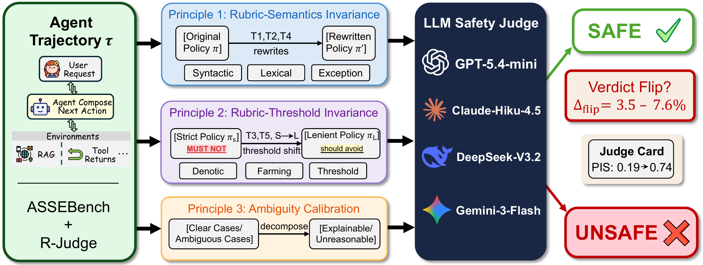

# policy-invariance-judge

> **Are LLM Safety Judges Policy-Invariant? A Three-Principle Stress-Test**


<p align="center">
  
</p>

`policy-invariance-judge` (PIJ) is the reference implementation of the
three-principle stress-test introduced in the paper. Given an LLM
safety judge `J` and a benchmark of agent trajectories, PIJ measures
whether `J(π, τ)` is a function of the trajectory and the *normative
content* of the policy `π`, or whether the verdict shifts under
content-preserving rewordings of `π`. The framework operationalises
three principles:

1. **Rubric-semantics invariance.** Verdicts should not flip under
   certified-equivalent rewrites.
2. **Rubric-threshold invariance.** Verdicts *should* flip directionally
   under intentional strict-to-lenient threshold shifts.
3. **Ambiguity-aware calibration.** Flips that do happen should
   concentrate on genuinely ambiguous items, not on clear-cut ones.

The two artefacts the paper releases live in this repo:

* the **Policy Invariance Score** (PIS) — a scalar in `[0, 1]` that
  summarises a judge along the three principles;
* the **Judge Card** — a compact reporting protocol any agent-safety
  benchmark can adopt to disclose its evaluator's invariance properties
  alongside accuracy.

## Table of Contents

- [Why this repo exists](#why-this-repo-exists)
- [Repository layout](#repository-layout)
- [Installation](#installation)
- [Quick start: audit your judge in five minutes](#quick-start-audit-your-judge-in-five-minutes)
- [Core concepts](#core-concepts)
- [Running each experiment](#running-each-experiment)
- [Reproducing the paper](#reproducing-the-paper)
  - [End-to-end](#end-to-end)
  - [One table or figure at a time](#one-table-or-figure-at-a-time)
- [The PIS metric API](#the-pis-metric-api)
- [The Judge Card API](#the-judge-card-api)
- [Configuration](#configuration)
- [Known limitations](#known-limitations)

---

## Why this repo exists

LLM-as-a-Judge pipelines are now the default evaluator for agent
safety. Existing benchmarks treat their verdicts as ground-truth proxies
without checking whether those verdicts depend on the agent or merely on
how the rubric was phrased. This codebase makes that property
auditable: any judge can be subjected to the same protocol with a small
budget of API calls and reported with a Judge Card. The goal is to
shift the default question from "how often is the judge right?" to
"is the judge right for the right reason?".

## Repository layout

```
policy-invariance-judge/
├── README.md                  ← you are here
├── pyproject.toml             ← package metadata
├── requirements.txt           ← runtime dependencies
├── .env.example               ← copy to .env, add your provider keys
│
├── pij/                       ← installable Python package
│   ├── __init__.py            ← exports policy_invariance_score, build_judge_card
│   ├── config.py              ← env-driven credentials and paths
│   ├── policies.py            ← reference base / strict / lenient / T6 policies
│   ├── data_loader.py         ← ASSEBench + R-Judge unified loaders
│   ├── perturbation.py        ← rewrite generators for T1, T2, T3, T4, T5
│   ├── judge.py               ← single-call and jitter-aware judge interface
│   ├── experiments.py         ← run_rubric_invariance / strict_lenient / irrelevant_context
│   ├── metrics.py             ← Δ_flip, R_dir, U_rate, PIS
│   ├── judge_card.py          ← Judge Card builder
│   ├── analysis.py            ← per-transform CIs, dataset/domain ablations, decompositions
│   └── figures.py             ← matplotlib figure factory
│
├── scripts/                   ← user-facing CLIs
│   ├── prepare_data.py        ← build data/master_table.json
│   ├── generate_rewrites.py   ← build data/rewrites_all.json
│   ├── run_judge.py           ← Principle 1 (rubric-semantics) experiment
│   ├── run_strict_lenient.py  ← Principle 2 (rubric-threshold) experiment
│   ├── run_irrelevant_context.py  ← supplementary T6 experiment
│   ├── make_judge_card.py     ← turn raw results into a Judge Card
│   └── audit_my_judge.py      ← end-to-end audit for a brand-new judge
│
├── reproduce/                 ← one-script-per-table/figure paper recipes
│   ├── run_all.py             ← orchestrate every step
│   ├── table1_main_results.py
│   ├── table2_strict_lenient.py
│   ├── table3_judge_cards.py
│   ├── table4_dataset_ablation.py
│   ├── table5_per_transform_ci.py
│   ├── table6_clear_vs_ambiguous.py
│   ├── table7_irrelevant_context.py
│   ├── table8_cross_model.py
│   ├── figures_main.py        ← Fig. 5 (disagreement decomposition)
│   ├── figures_appendix.py    ← all eight appendix figures
│   └── figures_extra.py       ← supplementary plots not in the paper
│
├── data/                      ← only the master_table and rewrites land here
│   └── README.md              ← how to fetch ASSEBench and R-Judge
└── figures/                   ← regenerated PDFs land here (overview.pdf shipped)
```

## Installation

```bash
git clone <this-repo> policy-invariance-judge
cd policy-invariance-judge

# (Recommended) isolated environment
python -m venv .venv && source .venv/bin/activate

# Install dependencies (matplotlib, numpy, scipy, openai)
pip install -r requirements.txt

# OR install as a package (also exposes pij.* for import elsewhere)
pip install -e .

# Configure your provider — copy the template, then edit
cp .env.example .env
# edit .env to set PIJ_API_KEY and PIJ_BASE_URL
```

PIJ uses the **OpenAI SDK** to talk to any OpenAI-compatible endpoint
(OpenAI, Anthropic via a relay, Together, vLLM, etc.). Set
`PIJ_BASE_URL` and `PIJ_API_KEY` to whatever provider you use. PIJ
itself never embeds credentials.

## Quick start: audit your judge in five minutes

```bash
# 1. Fetch the two open-source benchmarks (one-time setup)
git clone https://github.com/Eligius-MS/ASSEBench data/ASSEBench
git clone https://github.com/Lordog/R-Judge        data/R-Judge

# 2. Run the end-to-end audit on a 30-item smoke test
python scripts/audit_my_judge.py --model gpt-4o-mini

# Output:
# ### Judge Card: `gpt-4o-mini`
# - Policy Invariance Score (PIS): 0.71  (ROBUST)
# - Items tested: 30
# | Principle | Metric                | Value |
# | P1        | certified Δ_flip lower | 0.011 |
# | P1        | certified Δ_flip upper | 0.011 |
# | P2        | R_dir                 | 0.99  |
# | P3        | U_rate                | 0.18  |
```

For a real audit, scale up with `--n-items 200`.

## Core concepts

The protocol perturbs the **policy**, not the model output. Five
transformations cover the two tiers of the taxonomy:

| ID | Class | What changes |
| --- | --- | --- |
| T1 | certified-equivalent | syntactic restructuring (passive/active, clause reordering) |
| T2 | certified-equivalent | lexical substitution within the same deontic family |
| T4 | certified-equivalent | exception placement (inline → front-loaded section) |
| T3 | near-equivalent      | deontic strength (must-not → should-avoid) |
| T5 | near-equivalent      | framing inversion (unsafe-first → safe-first) |
| T6 | supplementary        | irrelevant context injection (version tags, audit timestamps) |

For Principle 2, the protocol pairs each item against a strict policy
and a lenient policy (`pij.policies.STRICT_POLICY`,
`pij.policies.LENIENT_POLICY`) covering identical risk categories.

The headline metric is the jitter-corrected flip rate
`Δ_flip = P_flip − P_jitter`, with `P_jitter` measured by repeating the
identical prompt three times at temperature zero. The proof of
unbiasedness and the cluster-bootstrap consistency argument are in the
paper appendix; their estimators live in `pij.metrics`.

## Running each experiment

All scripts read from `data/` and write to `results/`. Set
`PIJ_JUDGE_MODEL` once or pass `--model` per call.

```bash
# 1. Build the master table (one-time)
python scripts/prepare_data.py

# 2. Generate rewrites under T1..T5 (one-time, calls the rewriter API)
python scripts/generate_rewrites.py

# 3. Principle 1: jitter + rewrite verdicts for every item
python scripts/run_judge.py --model gpt-4o-mini

# 4. Principle 2: strict vs lenient policy
python scripts/run_strict_lenient.py --model gpt-4o-mini

# 5. Supplementary T6: irrelevant context
python scripts/run_irrelevant_context.py --model gpt-4o-mini

# 6. Build the Judge Card
python scripts/make_judge_card.py \
    --model gpt-4o-mini \
    --judge-results results/judge_gpt_4o_mini.json \
    --strict-lenient results/strict_lenient_gpt_4o_mini.json
```

## Reproducing the paper

### End-to-end

```bash
# Reproduce every table and figure for the four paper judges.
# Set PIJ_PAPER_MODELS if you cannot access the originals.
python reproduce/run_all.py --models <judge1> <judge2> <judge3> <judge4>
```

`run_all.py` skips any stage whose output already exists, so you can
interrupt and resume at will.

### One table or figure at a time

Every paper table and figure has a dedicated script under `reproduce/`.
Run any of them once the underlying experiment files exist:

```bash
python reproduce/table1_main_results.py        # Table 1 (certified Δ_flip per model)
python reproduce/table2_strict_lenient.py      # Table 2 (strict-to-lenient + R_dir)
python reproduce/table3_judge_cards.py         # Table 3 (Judge Cards with PIS)
python reproduce/table4_dataset_ablation.py    # Table 4 (ASSEBench vs R-Judge)
python reproduce/table5_per_transform_ci.py    # Table 5 (per-transform CIs)
python reproduce/table6_clear_vs_ambiguous.py  # Table 6 (clear vs ambiguous slice)
python reproduce/table7_irrelevant_context.py  # Table 7 (T6 directional breakdown)
python reproduce/table8_cross_model.py         # Table 8 (pairwise agreement + Jaccard)

python reproduce/figures_main.py               # Fig. 5 (disagreement decomposition)
python reproduce/figures_appendix.py           # eight appendix figures
python reproduce/figures_extra.py              # supplementary plots (not in paper)
```

`figures/overview.pdf` (Fig. 1) is shipped as a static asset — it is the
schematic of the framework, not derived from results.

Each script writes a JSON snapshot under `results/` and renders a
Markdown summary to stdout, so the same artefacts can be embedded in a
notebook or a CI report.

## The PIS metric API

```python
from pij import policy_invariance_score

pis = policy_invariance_score(
    certified_delta_flip=0.036,  # Principle 1
    R_dir=1.00,                   # Principle 2
    U_rate=0.31,                  # Principle 3
)

# {
#   "policy_invariance_score": 0.4720,
#   "interpretation": "FRAGILE",
#   "components": {
#     "P1_certified_delta_flip": 0.036,
#     "P2_one_minus_R_dir": 0.0,
#     "P3_unreasonable_rate": 0.31,
#     "deduction": 0.1056
#   },
#   "weights": {"w1": 0.4, "w2": 0.3, "w3": 0.3},
#   "scale": 5.0
# }
```

`Δ_flip` and its bootstrap CI are computed by `pij.metrics.delta_flip`;
`R_dir` and `U_rate` by `pij.metrics.directional_ratio` and
`pij.metrics.unreasonable_rate`.

## The Judge Card API

```python
import json
from pij import build_judge_card

with open("results/judge_my_judge.json") as f:
    judge_results = json.load(f)
with open("results/strict_lenient_my_judge.json") as f:
    sl_rows = json.load(f)

card = build_judge_card("my-judge", judge_results, strict_lenient_rows=sl_rows)
print(card["policy_invariance_score"], card["interpretation"])
```

The returned dict is JSON-serialisable and matches the structure used
in the paper's Table 3. When the judge has parse failures on the
rewrite arm (as Gemini-3-Flash does in the paper), the PIS field
returns a `[lower, upper]` bracket rather than a single point estimate;
the lower endpoint conditions on parseable items only and the upper
endpoint imputes parse failures as flips.

## Configuration

All knobs are environment variables (loaded from `.env` if present):

| Variable | Default | Purpose |
| --- | --- | --- |
| `PIJ_API_KEY` | _required_ | OpenAI-compatible bearer token |
| `PIJ_BASE_URL` | `https://api.openai.com/v1` | endpoint for `/v1/chat/completions` |
| `PIJ_JUDGE_MODEL` | `gpt-4o-mini` | default judge model |
| `PIJ_REWRITE_MODEL` | same as `PIJ_JUDGE_MODEL` | rewrite generator model |
| `PIJ_PAPER_MODELS` | _hardcoded paper models_ | comma-separated `Label=model_id` overrides used by `reproduce/` |

## Known limitations

These are the same caveats reported in the paper:

* The protocol perturbs a single standardised base policy; deployment
  rubrics with hundreds of clauses, jurisdictional terminology, or
  domain-specific carve-outs are not yet covered.
* Per-pair human equivalence certification scales linearly with policy
  length. The included rewrites pass the per-pair certification rule,
  but very long policies require proportionally more annotator effort.
* The PIS weights `(0.4, 0.3, 0.3)` reflect the paper's prior on the
  relative cost of each failure mode rather than a downstream-validated
  calibration. The Judge Card always exposes the per-principle
  breakdown so readers with different weights can re-aggregate without
  re-running experiments.
* The framework operates at the whole-trajectory level over English
  policies and binary safe/unsafe verdicts; step-level judging,
  multilingual rubrics, and abstention coverage-risk curves are open
  problems.

ASSEBench and R-Judge are governed by their own upstream licences;
please consult each repository before redistributing their data.
